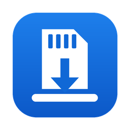
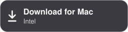
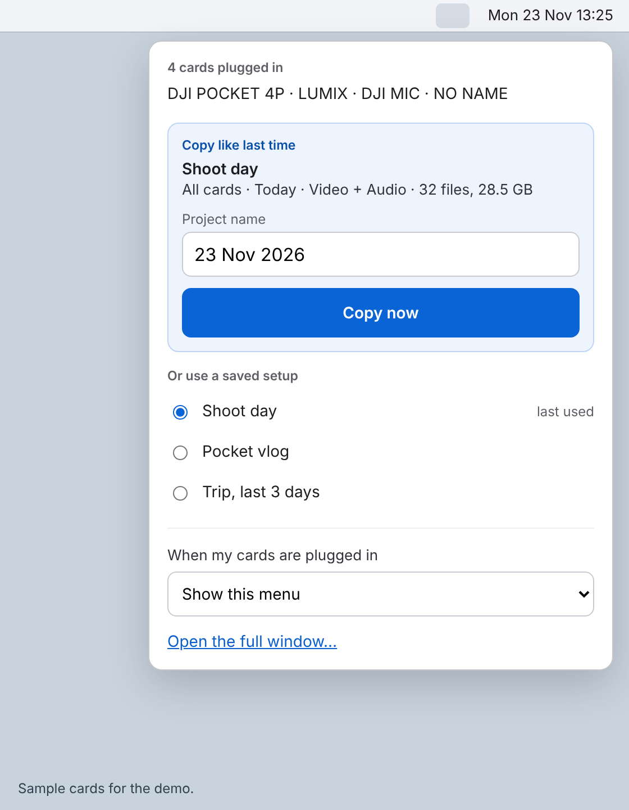
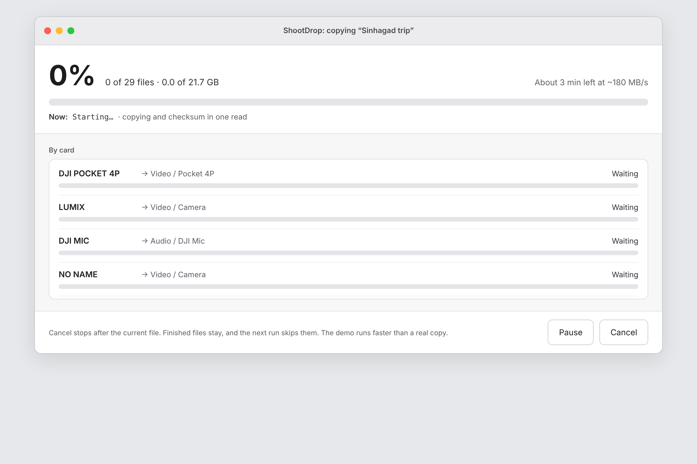
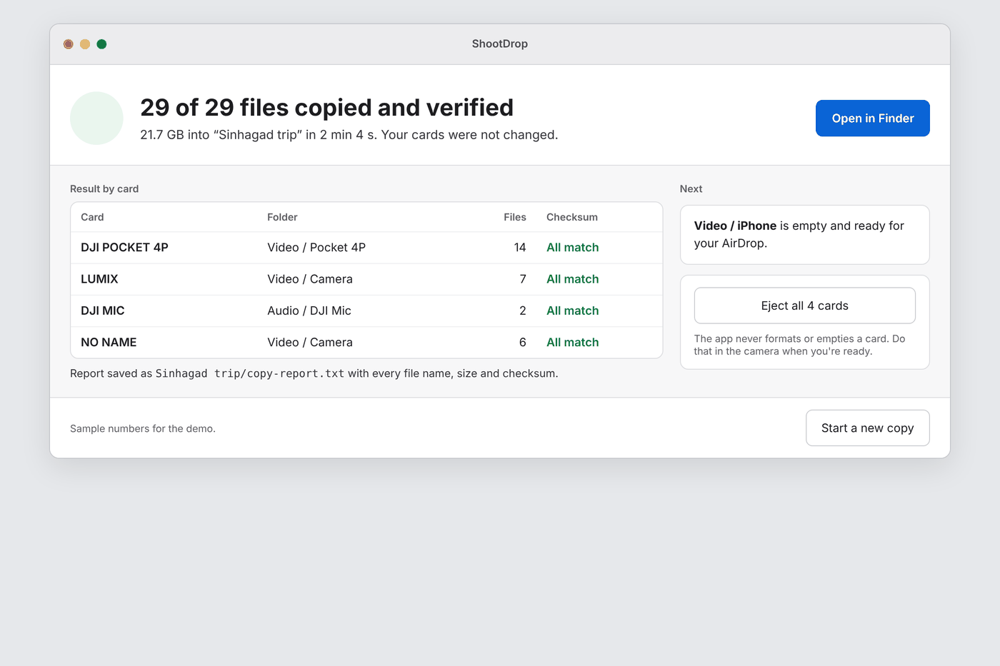
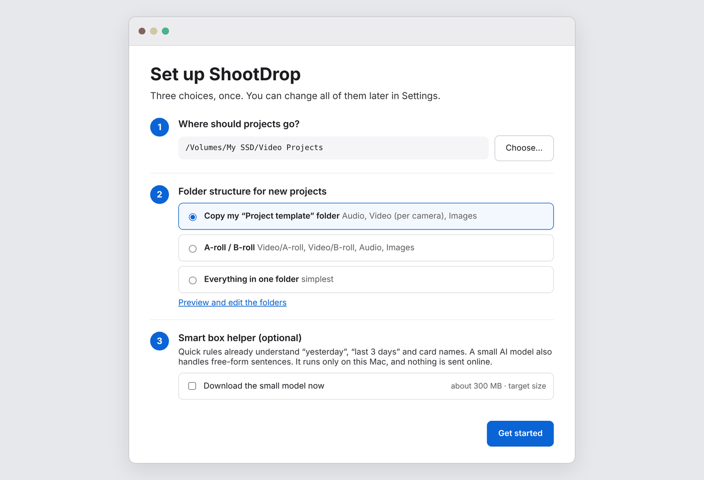
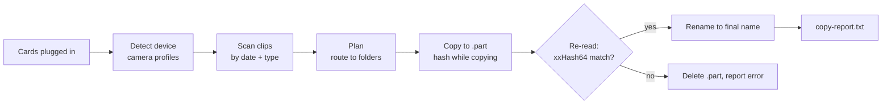

<p align="center">
  
</p>

<h1 align="center">ShootDrop</h1>

<p align="center">
  <b>Plug in your camera cards. Press Copy. Every clip lands in the right folder, checked byte for byte.</b>
</p>

<p align="center">
  <a href="https://github.com/nadeem74/ShootDrop/actions/workflows/ci.yml"></a>
  <a href="LICENSE"></a>
  
  
  
  <a href="CONTRIBUTING.md"></a>
  <a href="https://buymeacoffee.com/thelocalguide"></a>
</p>

<p align="center">
  <a href="https://github.com/nadeem74/ShootDrop/releases/latest/download/ShootDrop-macOS-Apple-Silicon.dmg"></a>
  <a href="https://github.com/nadeem74/ShootDrop/releases/latest/download/ShootDrop-macOS-Intel.dmg"></a>
  <a href="https://github.com/nadeem74/ShootDrop/releases/latest/download/ShootDrop-Windows.exe"></a>
  <a href="https://github.com/nadeem74/ShootDrop/releases/latest/download/ShootDrop-Linux.tar.gz"></a>
</p>

<p align="center">
  <sub>Mac with <a href="#mac-with-homebrew">Homebrew</a>? Install with three commands, no security warning. <a href="#mac-with-homebrew">See how</a>.</sub>
</p>

---

## TL;DR

You shot all day on a DJI Pocket, a Lumix and a DJI Mic. Now it's 11 pm and you have to:

1. make a project folder,
2. dig through three cards for *today's* clips,
3. drag videos into `Video/…` and audio into `Audio/…`,
4. hope nothing got corrupted on the way.

**ShootDrop does all four in one click.** It knows which card is which, picks only the days you want,
copies into *your* folder structure, and verifies every file with a checksum. Your cards are only ever read.

> Started as a small bash script on my Mac. Turned into a proper app because copying footage
> by hand every night is how clips get lost.

## What it looks like

<p align="center"></p>
<p align="center"><b>Main window</b>: pick cards, dates and file types, or type what you want in the smart box.</p>

<table>
<tr>
<td width="50%" valign="top"><br><b>Ready to copy</b><br><sub>Opens on this. One button copies with your last setup.</sub></td>
<td width="50%" valign="top"><br><b>Menu bar quick copy</b><br><sub>Copy from the menu bar without opening the window.</sub></td>
</tr>
<tr>
<td width="50%" valign="top"><br><b>Review</b><br><sub>What goes where, free space and safety checks before copying.</sub></td>
<td width="50%" valign="top"><br><b>Copying and verifying</b><br><sub>Progress per card. Every file is checked after it's copied.</sub></td>
</tr>
<tr>
<td width="50%" valign="top"><br><b>Done</b><br><sub>All files verified. Open in Finder, eject the cards.</sub></td>
<td width="50%" valign="top"><br><b>First-run setup</b><br><sub>Where projects go, your folder structure, the optional AI helper.</sub></td>
</tr>
<tr>
<td width="50%" valign="top"><br><b>Folder structure editor</b><br><sub>Your template or A-roll / B-roll, and where each camera's files land.</sub></td>
<td width="50%" valign="top"><br><b>Settings</b><br><sub>Projects folder, cameras, file types, after-copy actions.</sub></td>
</tr>
</table>

<sub>These are the design wireframes the app was built from (sample cards and numbers). More in <a href="docs/WIREFRAMES.md">docs/WIREFRAMES.md</a>.</sub>

## Who it's for

| If you… | ShootDrop gives you… |
| --- | --- |
| post Reels, Shorts and vlogs from 2–4 devices | one button: **Copy like last time** |
| shoot weddings, events or podcasts | per-card routing, date ranges, a copy report in every project |
| just want the family trip off the camera without thinking | it finds the card, you press Copy, done |
| are a developer | a clean .NET 10 codebase with tests, ADRs and a CLI to learn from or extend |

## Why you can trust it with footage

Safety rules are written into the architecture ([ADR-003](docs/adr/0003-architecture.md)) and covered by tests:

- 🔒 **Cards are read-only.** ShootDrop never writes, renames, deletes or formats anything on a card.
- ✅ **Every file is verified.** Each copy is re-read and its [xxHash64](docs/adr/0004-checksum-xxhash64.md) must match the source before it counts as done.
- 🧩 **No half files.** Copies are written as `name.part` and renamed only after they pass the check. Cancel or pull the drive, and nothing broken is left behind.
- 🙅 **Never overwrites.** Same file already there → skipped. Same name, different content → saved as `name (2)`.
- 🧾 **Receipts.** A `copy-report.txt` in each project lists every file, size and checksum.

## Features

- **Knows your gear.** Detects DJI Osmo Pocket, Panasonic Lumix and DJI Mic out of the box. Adding a camera is one small [JSON file](#add-your-camera).
- **Your folders, your way.** Use your own template folder, or presets like `Audio / Video/<camera> / Images` or A-roll / B-roll.
- **Smart routing.** Video from each camera goes to its own folder. Audio tracks (like the DJI Pocket's `.AAC` mic files) go to `Audio/`. Proxies (`.LRF`) are skipped unless you want them.
- **Pick the day.** Today, yesterday, the last N days, or any date range.
- **One-click repeat.** Save setups like "Shoot day" or "Pocket vlog". The app opens on a small **Ready to copy** window with one **Copy now** button.
- **Talk to it.** Type `all cards, yesterday for Sinhagad trip` or `kal ka sab footage with photos` (yes, Hinglish works).
- **Lives in your menu bar.** Close the window and ShootDrop keeps waiting quietly, using almost nothing. Copy now right from the menu.
- **Pops up when you plug in a card** (or copies automatically, or does nothing: your choice).
- **Global shortcut**, ⌃⌥⌘C by default, change it to anything you like. **Start at login** if you want.
- **Add your own cameras in the app.** Plug in the card, click *Fill in from this card*, save. No config files.
- **Drag and drop folders** to reshape your project, and drop a camera onto a folder to send its files there.
- Open in Finder and Eject cards when the copy finishes.
- **CLI included.** Same engine, scriptable: `shootdrop copy --date yesterday --name "Goa trip"`.

## AI: where it is and where it's going 🤖

The smart box is built **AI-ready, rules-first**, on purpose ([ADR-005](docs/adr/0005-smart-box-and-local-ai.md)):

- **Today (v0.1):** a fast, fully tested rule parser turns plain sentences into a copy filter: dates, card names,
  file types, project name, English and Hinglish. No model, no download, works offline, never guesses.
- **Next (v0.2):** sentences the rules don't understand go to a **tiny local language model** (≈0.3–0.5B parameters,
  GGUF via [LLamaSharp](https://github.com/SciSharp/LLamaSharp)/llama.cpp). It runs **on your machine, offline**, its
  output is forced into a JSON schema and validated, and **you always confirm before anything is copied**.
  The AI fills in the form. It never presses the button.
- **The learning part:** an eval set built from the rule tests, synthetic training pairs, a LoRA fine-tune, then the
  smallest model that hits the accuracy target. All of it will be in this repo. See [docs/AI.md](docs/AI.md).

Want to work on on-device AI in .NET? This is a good place to start. 👀

## Get it

### Download

| | File | First time |
| --- | --- | --- |
| Mac (Apple Silicon, M1–M4) | [ShootDrop-macOS-Apple-Silicon.dmg](https://github.com/nadeem74/ShootDrop/releases/latest/download/ShootDrop-macOS-Apple-Silicon.dmg) | Open the .dmg, drag ShootDrop to Applications. See [first launch on a Mac](#first-launch-on-a-mac) |
| Mac (Intel) | [ShootDrop-macOS-Intel.dmg](https://github.com/nadeem74/ShootDrop/releases/latest/download/ShootDrop-macOS-Intel.dmg) | Same |
| Windows | [ShootDrop-Windows.exe](https://github.com/nadeem74/ShootDrop/releases/latest/download/ShootDrop-Windows.exe) | Double-click. If Windows warns: **More info** → **Run anyway** |
| Linux | [ShootDrop-Linux.tar.gz](https://github.com/nadeem74/ShootDrop/releases/latest/download/ShootDrop-Linux.tar.gz) | `tar -xzf ShootDrop-Linux.tar.gz && ./ShootDrop/ShootDrop` |

Not sure which Mac you have? Apple menu → **About This Mac**: "Apple M…" is Apple Silicon.

### Mac with Homebrew

If you use [Homebrew](https://brew.sh), this is the easiest way. It picks the right build for your chip and opens with no warning:

Open **Terminal** and paste:

```bash
brew tap nadeem74/shootdrop https://github.com/nadeem74/ShootDrop
brew trust nadeem74/shootdrop
brew install --cask shootdrop
```

What each line does:
1. `brew tap` tells Homebrew where ShootDrop lives (this GitHub repo).
2. `brew trust` is your one-time OK for Homebrew to install from a source outside its own list.
3. `brew install` downloads the latest release for your Mac's chip and puts ShootDrop in Applications.

You only need lines 1 and 2 once per Mac.

Update with `brew upgrade --cask --greedy shootdrop`. Remove with `brew uninstall --cask shootdrop`
(add `--zap` to also delete your settings).

### First launch on a Mac

ShootDrop isn't notarised by Apple yet (that needs a paid Apple Developer ID; it's on the [roadmap](docs/ROADMAP.md)).
So the first time you open the .dmg version, macOS says it **could not verify** ShootDrop. To allow it, once:

1. Click **Done** on the warning.
2. Open **System Settings → Privacy & Security**, scroll down to **Security**.
3. Next to *"ShootDrop" was blocked*, click **Open Anyway**, then **Open**, and enter your Mac password.

After that it opens normally. (Right-click → Open no longer works since macOS 15 Sequoia.)
The Homebrew install above skips this step.

### Platform status

| Platform | Status |
| --- | --- |
| macOS 12+ (Apple Silicon) | ✅ Daily use, tested on real DJI and Lumix cards |
| macOS (Intel) | 🧪 Builds in CI, needs a tester |
| Linux (x64) | 🧪 Builds and core tests pass in CI, **needs testers** with real cards |
| Windows (x64) | 🧪 Builds in CI, **needs testers** with real cards |

**Got a Linux or Windows machine and a camera card? You're exactly who we need.**
Open a [platform test report](https://github.com/nadeem74/ShootDrop/issues/new?template=platform_test.yml) and tell us what worked.

### Build from source

Needs the [.NET 10 SDK](https://dotnet.microsoft.com/download).

```bash
git clone https://github.com/nadeem74/ShootDrop.git
cd ShootDrop
dotnet test ShootDrop.slnx                       # runs against fake cards, no hardware needed
dotnet run --project src/ShootDrop.App           # the app
dotnet run --project src/ShootDrop.Cli -- help   # the CLI
```

On a Mac you can also double-click `scripts/macos/setup.command` (installs .NET if missing, builds, tests) and
`scripts/macos/build-app.command` (builds and opens `ShootDrop.app`).

## The CLI

```bash
shootdrop config --root "/Volumes/My SSD/Video Projects"   # where projects go
shootdrop cards                                             # what's plugged in
shootdrop plan --date yesterday --name "Sinhagad trip"      # dry run, copies nothing
shootdrop copy --date yesterday --name "Sinhagad trip"      # the real thing
shootdrop ask  "Pocket only, last 3 days"                   # test the smart box
```

## Add your camera

Easiest: **Settings › Cameras › + Add camera**, plug in the card and click *Fill in from this card*.

Or drop a JSON file in `profiles/` (or in `~/Library/Application Support/ShootDrop/profiles/` on your machine):

```json
{
  "id": "gopro-hero",
  "name": "GoPro HERO",
  "defaultFolder": "Video/GoPro",
  "match": { "dcimFolderContains": ["GOPRO"] }
}
```

Send it as a pull request and everyone with that camera benefits. Sony, Canon, GoPro, Insta360 and Zoom
recorders are all wanted.

## How it works



All of this lives in `ShootDrop.Core`, which has no UI code. The desktop app and the CLI are thin layers on top.
More in [docs/ARCHITECTURE.md](docs/ARCHITECTURE.md).

## Under the hood

| | |
| --- | --- |
| Language / runtime | C# on .NET 10 |
| UI | Avalonia 11 (cross-platform XAML), MVVM with CommunityToolkit.Mvvm, compiled bindings |
| Integrity | xxHash64 (System.IO.Hashing), streaming hash during copy, verify-then-rename |
| Tests | xUnit, fake camera cards generated in temp folders, CI on macOS, Linux and Windows |
| Delivery | GitHub Actions: tests on every push, release builds for 4 platforms on every tag |
| Process | [Wireframes](docs/WIREFRAMES.md) first, PRD with requirement IDs, [Architecture Decision Records](docs/adr), small PRs |
| AI (v0.2) | LLamaSharp + GGUF small language model, JSON-schema-constrained output |

## Contributing

PRs are welcome, big or small. Fork it, fix it, add your camera, port it, or use it in your own project:
it's MIT, so do whatever you like with it. Good first steps:

- 🧪 **Test on Linux or Windows** and report what breaks
- 📷 **Add a camera profile** for your gear
- 🤖 **Help build the local AI smart box** (v0.2)
- 🐛 Bugs and ideas → [Issues](https://github.com/nadeem74/ShootDrop/issues)

Read [CONTRIBUTING.md](CONTRIBUTING.md) first; the one hard rule is that footage safety always wins.

## Roadmap

See [docs/ROADMAP.md](docs/ROADMAP.md). v0.2 brought the menu bar, shortcut, start at login and the in-app camera editor.
Next up: the local AI model, a signed and notarised macOS build, and community-tested Linux and Windows releases.

## Built by

**Nadeem Ahmed**, software architect and YouTube creator (Thelocalguide), who needed this for his own shoots.
He designed the screens and the architecture, wrote the specs and ADRs, and reviewed every change. The code was pair-programmed
with an AI coding agent ([Claude Code](https://claude.com/claude-code)); the rules it follows are in [CLAUDE.md](CLAUDE.md).

[LinkedIn](https://www.linkedin.com/in/nadeem12) · [GitHub](https://github.com/nadeem74)

## Support ShootDrop

ShootDrop is free and will stay free. If it saves you time after a long shoot, you can
[buy me a coffee ☕](https://buymeacoffee.com/thelocalguide). It helps pay for the Apple Developer ID,
so the Mac app can open without any warning.

<a href="https://buymeacoffee.com/thelocalguide"></a>

## License

[MIT](LICENSE) © 2026 Nadeem Ahmed. Free to use, change and share.
