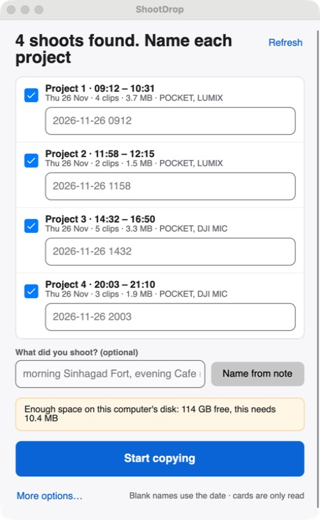
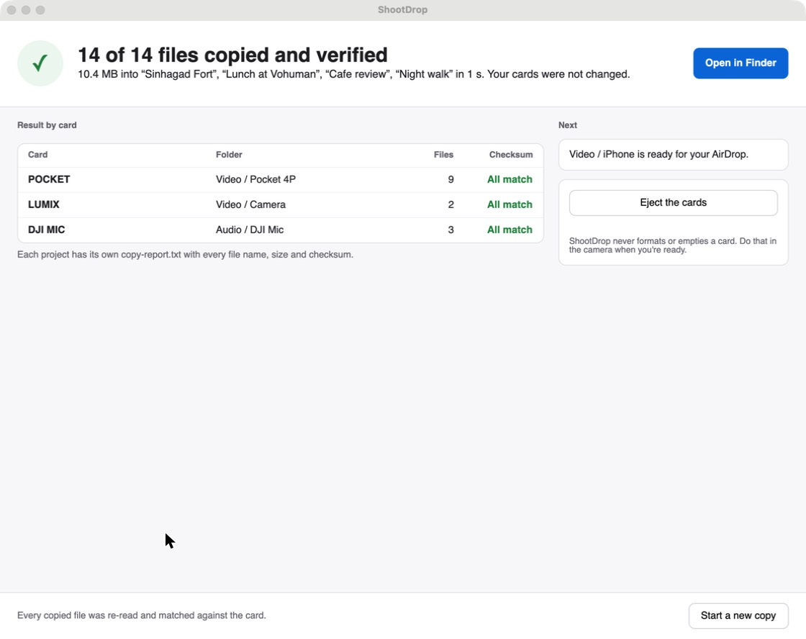
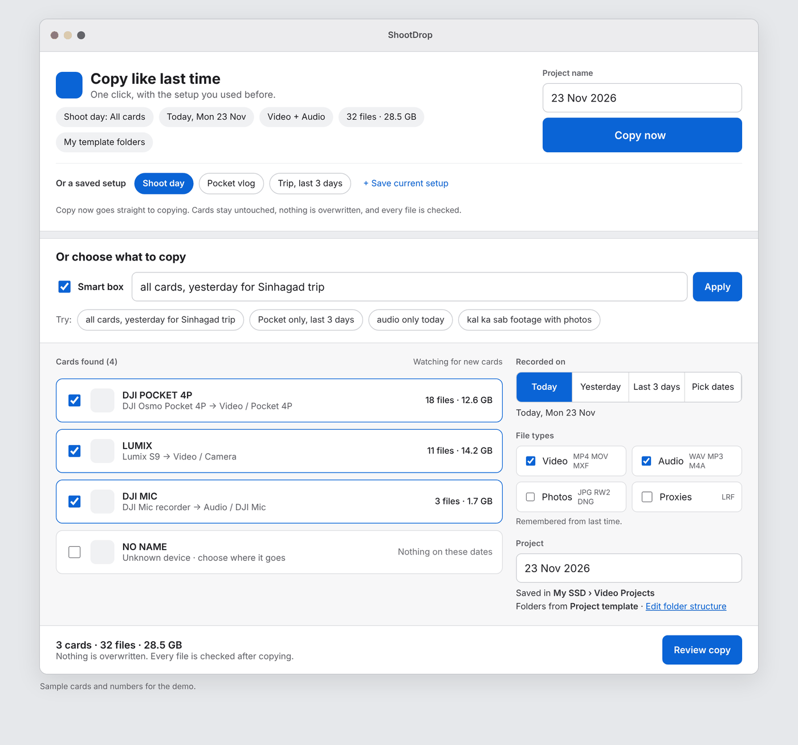
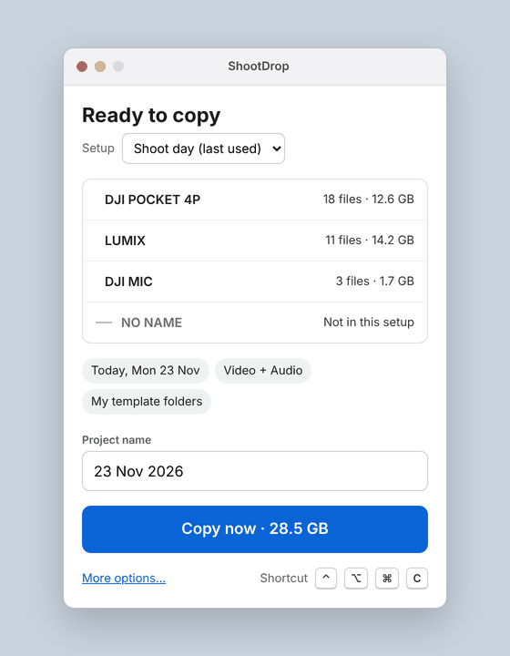
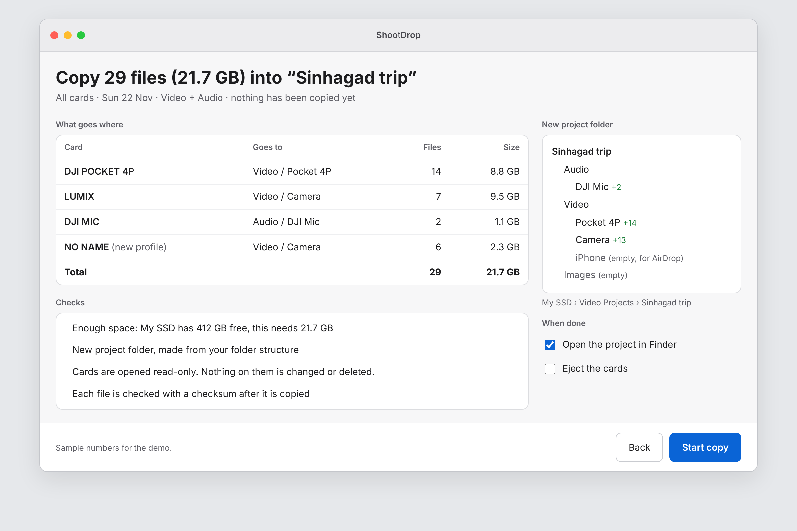
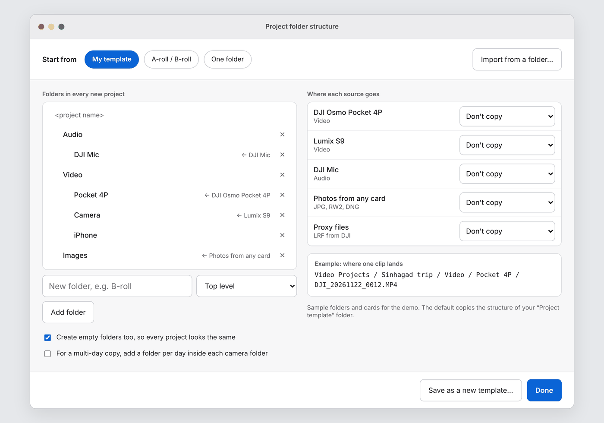
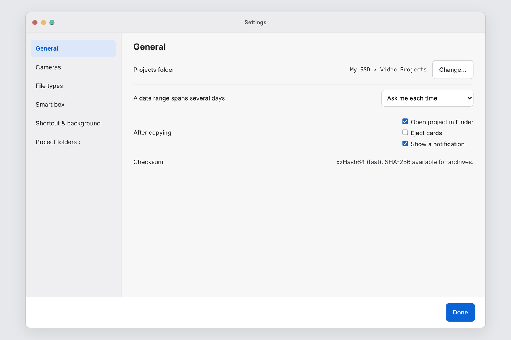
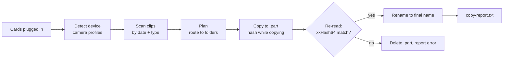

<p align="center">
  
</p>

<h1 align="center">ShootDrop</h1>

<p align="center">
  <b>Plug in your camera cards. Press Copy. Every clip lands in the right folder, checked byte for byte.</b>
</p>

<p align="center">
  <a href="https://github.com/nadeem74/ShootDrop/actions/workflows/ci.yml"></a>
  <a href="LICENSE"></a>
  
  
  
  <a href="CONTRIBUTING.md"></a>
  <a href="https://buymeacoffee.com/thelocalguide"></a>
</p>

<p align="center">
  <a href="https://github.com/nadeem74/ShootDrop/releases/latest/download/ShootDrop-macOS-Apple-Silicon.dmg"></a>
  <a href="https://github.com/nadeem74/ShootDrop/releases/latest/download/ShootDrop-macOS-Intel.dmg"></a>
  <a href="https://github.com/nadeem74/ShootDrop/releases/latest/download/ShootDrop-Windows.exe"></a>
  <a href="https://github.com/nadeem74/ShootDrop/releases/latest/download/ShootDrop-Linux.tar.gz"></a>
</p>

<p align="center">
  <sub>Mac with <a href="#mac-with-homebrew">Homebrew</a>? Install with three commands, no security warning. <a href="#mac-with-homebrew">See how</a>.</sub><br>
  <sub><a href="CODE_SIGNING_POLICY.md">Code signing policy</a> · Free code signing provided by SignPath.io, certificate by SignPath Foundation.</sub>
</p>

---

## TL;DR

You shot all day on a DJI Pocket, a Lumix and a DJI Mic. Now it's 11 pm and you have to:

1. make a project folder,
2. dig through three cards for *today's* clips,
3. drag videos into `Video/…` and audio into `Audio/…`,
4. hope nothing got corrupted on the way.

**ShootDrop does all four for you.** Put the cards in and it opens by itself: *"4 shoots found. Name each project."*
Type the names (or leave them blank for a date name), press **Start**, and walk away. It knows which card is which,
splits the day into shoots by the breaks in recording, copies into *your* folder structure and verifies every file
with a checksum. Your cards are only ever read.

> Started as a small bash script on my Mac. Turned into a proper app because copying footage
> by hand every night is how clips get lost.

## What it looks like

<table>
<tr>
<td width="38%" valign="top"><br><b>Cards in → this opens by itself</b><br><sub>New shoots found from the breaks in recording, per card. Name each project or leave it blank for a date name. One Start.</sub></td>
<td width="62%" valign="top"><br><b>Done, all verified</b><br><sub>Four projects from one day, every file re-read and matched. A Mac notification tells you when it's finished.</sub></td>
</tr>
</table>
<sub>Real screenshots of v0.4 (demo with fake cards).</sub>

### The design it started from

<p align="center"></p>
<p align="center"><b>Main window</b>: pick cards, dates and file types, or type what you want in the smart box.</p>

<table>
<tr>
<td width="50%" valign="top"><br><b>Ready to copy</b><br><sub>Opens on this. One button copies with your last setup.</sub></td>
<td width="50%" valign="top"><br><b>Menu bar quick copy</b><br><sub>Copy from the menu bar without opening the window.</sub></td>
</tr>
<tr>
<td width="50%" valign="top"><br><b>Review</b><br><sub>What goes where, free space and safety checks before copying.</sub></td>
<td width="50%" valign="top"><br><b>Copying and verifying</b><br><sub>Progress per card. Every file is checked after it's copied.</sub></td>
</tr>
<tr>
<td width="50%" valign="top"><br><b>Done</b><br><sub>All files verified. Open in Finder, eject the cards.</sub></td>
<td width="50%" valign="top"><br><b>First-run setup</b><br><sub>Where projects go, your folder structure, the optional AI helper.</sub></td>
</tr>
<tr>
<td width="50%" valign="top"><br><b>Folder structure editor</b><br><sub>Your template or A-roll / B-roll, and where each camera's files land.</sub></td>
<td width="50%" valign="top"><br><b>Settings</b><br><sub>Projects folder, cameras, file types, after-copy actions.</sub></td>
</tr>
</table>

<sub>These are the design wireframes the app was built from (sample cards and numbers). More in <a href="docs/WIREFRAMES.md">docs/WIREFRAMES.md</a>.</sub>

## Who it's for

| If you… | ShootDrop gives you… |
| --- | --- |
| post Reels, Shorts and vlogs from 2–4 devices | cards in, name the shoots, **Start**. That's it |
| shoot weddings, events or podcasts | per-card routing, date ranges, a copy report in every project |
| just want the family trip off the camera without thinking | it opens when the card goes in, you press Start, done |
| are a developer | a clean .NET 10 codebase with tests, ADRs and a CLI to learn from or extend |

## Why you can trust it with footage

Safety rules are written into the architecture ([ADR-003](docs/adr/0003-architecture.md)) and covered by tests:

- 🔒 **Cards are read-only.** ShootDrop never writes, renames, deletes or formats anything on a card.
- ✅ **Every file is verified.** Each copy is re-read and its [xxHash64](docs/adr/0004-checksum-xxhash64.md) must match the source before it counts as done.
- 🧩 **No half files.** Copies are written as `name.part` and renamed only after they pass the check. Cancel or pull the drive, and nothing broken is left behind.
- 🙅 **Never overwrites.** Same file already there → skipped. Same name, different content → saved as `name (2)`.
- 🧾 **Receipts.** A `copy-report.txt` in each project lists every file, size and checksum.

## Features

**Put the cards in, press Start** *(new in v0.4)*
- **Opens by itself when a card goes in** and shows only what's new: per card it remembers what was already copied.
- **Finds the shoots for you.** Clips are grouped wherever recording paused (1 hour by default, slider from 15 min to 4 h), so one day becomes "Sinhagad Fort, Lunch, Cafe review, Night walk".
- **Asks you for the names.** One box per shoot; a blank box gets the date and time of its first clip, like `2026-11-27 0915`.
- **Name them from one sentence:** type `morning Sinhagad Fort, Lunch at Vohuman, Cafe review, Night walk` (Hinglish too: `subah Fort aur phir cafe`). Optional: let Claude suggest names; it may only use names from your note or your existing projects.
- **Notification when it's done**, with how many files were verified.

**iPhone too, over the cable** *(new, macOS)*
- **Plug in your iPhone and unlock it.** ShootDrop reads its new videos (with Apple's own Image Capture system), groups them into shoots by when they were recorded and opens the same "Name each project" screen. They land in `Video/iPhone`.
- Only new videos: the first time just the latest day, after that only what was recorded since. Files with the same name (`IMG_1352.MOV` from two years) are told apart.
- The phone is only read, never changed. An iPhone can't give a checksum, so ShootDrop checks each video's size against the phone, then verifies the copy into your project by checksum as usual.

**Never lose a clip**
- **Verified copies.** Every file is re-read and its xxHash64 must match the card. Cards are opened read-only, never overwritten, never formatted.
- **Resume after a cut.** Card pulled out, power cut, app closed? Next time ShootDrop offers **Resume** and copies only what's left.
- **Red when something's wrong.** Projects drive not connected, not enough space, unknown card: shown in red, and copying can't start.
- **Ignores drives that aren't cards**, like your backup disk.

**Split a day into projects**
- **Timeline:** the day's clips as coloured groups. Tick or untick whole groups or single clips, rename, merge, or start a new group at any clip.
- **Or just type it:** `yesterday till 1 pm into Fort, till 6 pm into Cafe and after 6 pm into Night walk`.
- Review shows each project, the clips outside every time, and each card's first and last clip time, so a wrong camera clock is easy to spot. One report per project.

**Fits how you work**
- **Knows your gear.** DJI Osmo Pocket, Panasonic Lumix and DJI Mic out of the box. Add any camera in the app: plug in its card, click *Fill in from this card*, save.
- **Your folders, your way.** Your own template folder (e.g. with a DaVinci project inside), or presets like `Audio / Video/<camera> / Images` or A-roll / B-roll. Drag and drop to reshape, drop a camera onto a folder to send its files there.
- **Smart routing.** Video per camera, audio (like the Pocket's `.AAC` mic files) to `Audio/`, proxies (`.LRF`) skipped unless you want them.
- **Pick the day** (today, yesterday, last N days, any range), save setups, or **Copy like last time** in one click.
- **Runs as a service.** Starts at login, waits in the menu bar using almost nothing, restarts itself if it ever crashes. Global shortcut ⌃⌥⌘C (change it to anything).
- Open in Finder and eject the cards when the copy finishes. The window keeps its size and place.

**For developers and AI apps**
- **CLI on the same engine:** `shootdrop auto` (the autopilot in a terminal), `shootdrop copy --date yesterday --name "Goa trip"`.
- **MCP server:** `shootdrop mcp` lets AI apps like Claude Desktop list cards, find new shoots, check space and copy.
- **Learn how it was built:** [docs/AGENTS-GUIDE.md](docs/AGENTS-GUIDE.md) walks through the autopilot and the agent step by step.

## AI: where it is and where it's going 🤖

The smart box is built **AI-ready, rules-first**, on purpose ([ADR-005](docs/adr/0005-smart-box-and-local-ai.md)):

- **Today (v0.1):** a fast, fully tested rule parser turns plain sentences into a copy filter: dates, card names,
  file types, project name, English and Hinglish. No model, no download, works offline, never guesses.
- **Next (v0.2):** sentences the rules don't understand go to a **tiny local language model** (≈0.3–0.5B parameters,
  GGUF via [LLamaSharp](https://github.com/SciSharp/LLamaSharp)/llama.cpp). It runs **on your machine, offline**, its
  output is forced into a JSON schema and validated, and **you always confirm before anything is copied**.
  The AI fills in the form; you press Start.
- **The learning part:** an eval set built from the rule tests, synthetic training pairs, a LoRA fine-tune, then the
  smallest model that hits the accuracy target. All of it will be in this repo. See [docs/AI.md](docs/AI.md).

**Autopilot and agent (v0.4, [ADR-008](docs/adr/0008-autopilot-and-agent.md)):** cards in → one screen with the new
recording sessions and dated names → **Start**. Optionally write what you shot ("morning Sinhagad Fort, evening Cafe
review") and the sessions are named from it, by rules or by Claude with an API key. The agent only gets read-only tools,
and a name that isn't in your note or your existing projects is refused. `shootdrop mcp` offers the same tools to AI apps.
How it's built, step by step: [docs/AGENTS-GUIDE.md](docs/AGENTS-GUIDE.md).

Want to work on on-device AI in .NET? This is a good place to start. 👀

## Get it

### Download

| | File | First time |
| --- | --- | --- |
| Mac (Apple Silicon, M1–M4) | [ShootDrop-macOS-Apple-Silicon.dmg](https://github.com/nadeem74/ShootDrop/releases/latest/download/ShootDrop-macOS-Apple-Silicon.dmg) | Open the .dmg, drag ShootDrop to Applications. See [first launch on a Mac](#first-launch-on-a-mac) |
| Mac (Intel) | [ShootDrop-macOS-Intel.dmg](https://github.com/nadeem74/ShootDrop/releases/latest/download/ShootDrop-macOS-Intel.dmg) | Same |
| Windows | [ShootDrop-Windows.exe](https://github.com/nadeem74/ShootDrop/releases/latest/download/ShootDrop-Windows.exe) | Double-click. No installer needed. If Windows warns: **More info** → **Run anyway** (signing is on its way, see the [code signing policy](CODE_SIGNING_POLICY.md)) |
| Linux | [ShootDrop-Linux.tar.gz](https://github.com/nadeem74/ShootDrop/releases/latest/download/ShootDrop-Linux.tar.gz) | `tar -xzf ShootDrop-Linux.tar.gz && ./ShootDrop/ShootDrop` |

Not sure which Mac you have? Apple menu → **About This Mac**: "Apple M…" is Apple Silicon.

### Code signing policy

Windows releases are being set up for free code signing: free code signing provided by SignPath.io,
certificate by SignPath Foundation. Who builds, reviews and approves signed releases, and what ShootDrop does
(and doesn't do) with your data, is in the [code signing policy](CODE_SIGNING_POLICY.md).
Short version: ShootDrop sends nothing over the internet unless you ask it to.

### Mac with Homebrew

If you use [Homebrew](https://brew.sh), this is the easiest way. It picks the right build for your chip and opens with no warning:

Open **Terminal** and paste:

```bash
brew tap nadeem74/shootdrop https://github.com/nadeem74/ShootDrop
brew trust nadeem74/shootdrop
brew install --cask shootdrop
```

What each line does:
1. `brew tap` tells Homebrew where ShootDrop lives (this GitHub repo).
2. `brew trust` is your one-time OK for Homebrew to install from a source outside its own list.
3. `brew install` downloads the latest release for your Mac's chip and puts ShootDrop in Applications.

You only need lines 1 and 2 once per Mac.

Update with `brew upgrade --cask --greedy shootdrop`. Remove with `brew uninstall --cask shootdrop`
(add `--zap` to also delete your settings).

### First launch on a Mac

ShootDrop isn't notarised by Apple yet (that needs a paid Apple Developer ID; it's on the [roadmap](docs/ROADMAP.md)).
So the first time you open the .dmg version, macOS says it **could not verify** ShootDrop. To allow it, once:

1. Click **Done** on the warning.
2. Open **System Settings → Privacy & Security**, scroll down to **Security**.
3. Next to *"ShootDrop" was blocked*, click **Open Anyway**, then **Open**, and enter your Mac password.

After that it opens normally. (Right-click → Open no longer works since macOS 15 Sequoia.)
The Homebrew install above skips this step.

### Platform status

| Platform | Status |
| --- | --- |
| macOS 12+ (Apple Silicon) | ✅ Daily use, tested on real DJI and Lumix cards |
| macOS (Intel) | 🧪 Builds in CI, needs a tester |
| Linux (x64) | 🧪 Builds and core tests pass in CI, **needs testers** with real cards |
| Windows (x64) | 🧪 Builds in CI, **needs testers** with real cards |

**Got a Linux or Windows machine and a camera card? You're exactly who we need.**
Open a [platform test report](https://github.com/nadeem74/ShootDrop/issues/new?template=platform_test.yml) and tell us what worked.

### Build from source

Needs the [.NET 10 SDK](https://dotnet.microsoft.com/download).

```bash
git clone https://github.com/nadeem74/ShootDrop.git
cd ShootDrop
dotnet test ShootDrop.slnx                       # runs against fake cards, no hardware needed
dotnet run --project src/ShootDrop.App           # the app
dotnet run --project src/ShootDrop.Cli -- help   # the CLI
```

On a Mac you can also double-click `scripts/macos/setup.command` (installs .NET if missing, builds, tests) and
`scripts/macos/build-app.command` (builds and opens `ShootDrop.app`).

## The CLI

```bash
shootdrop config --root "/Volumes/My SSD/Video Projects"   # where projects go
shootdrop cards                                             # what's plugged in
shootdrop plan --date yesterday --name "Sinhagad trip"      # dry run, copies nothing
shootdrop copy --date yesterday --name "Sinhagad trip"      # the real thing
shootdrop ask  "Pocket only, last 3 days"                   # test the smart box
shootdrop auto --note "morning Fort, evening Cafe review"   # autopilot: new shoots, named, one question
shootdrop mcp                                               # tools for AI apps (Claude Desktop etc.)
```

## Add your camera

Easiest: **Settings › Cameras › + Add camera**, plug in the card and click *Fill in from this card*.

Or drop a JSON file in `profiles/` (or in `~/Library/Application Support/ShootDrop/profiles/` on your machine):

```json
{
  "id": "gopro-hero",
  "name": "GoPro HERO",
  "defaultFolder": "Video/GoPro",
  "match": { "dcimFolderContains": ["GOPRO"] }
}
```

Send it as a pull request and everyone with that camera benefits. Sony, Canon, GoPro, Insta360 and Zoom
recorders are all wanted.

## How it works



All of this lives in `ShootDrop.Core`, which has no UI code. The desktop app and the CLI are thin layers on top.
More in [docs/ARCHITECTURE.md](docs/ARCHITECTURE.md).

## Under the hood

| | |
| --- | --- |
| Language / runtime | C# on .NET 10 |
| UI | Avalonia 11 (cross-platform XAML), MVVM with CommunityToolkit.Mvvm, compiled bindings |
| Integrity | xxHash64 (System.IO.Hashing), streaming hash during copy, verify-then-rename |
| Tests | xUnit, fake camera cards generated in temp folders, CI on macOS, Linux and Windows |
| Delivery | GitHub Actions: tests on every push, release builds for 4 platforms on every tag |
| Process | [Wireframes](docs/WIREFRAMES.md) first, PRD with requirement IDs, [Architecture Decision Records](docs/adr), small PRs |
| AI (v0.2) | LLamaSharp + GGUF small language model, JSON-schema-constrained output |

## Contributing

PRs are welcome, big or small. Fork it, fix it, add your camera, port it, or use it in your own project:
it's MIT, so do whatever you like with it. Good first steps:

- 🧪 **Test on Linux or Windows** and report what breaks
- 📷 **Add a camera profile** for your gear
- 🤖 **Help build the local AI smart box** (v0.2)
- 🐛 Bugs and ideas → [Issues](https://github.com/nadeem74/ShootDrop/issues)

Read [CONTRIBUTING.md](CONTRIBUTING.md) first; the one hard rule is that footage safety always wins.

## Roadmap

See [docs/ROADMAP.md](docs/ROADMAP.md). v0.2 brought the menu bar, shortcut, start at login and the in-app camera editor.
Next up: the local AI model, a signed and notarised macOS build, and community-tested Linux and Windows releases.

## Built by

**Nadeem Ahmed**, software architect and YouTube creator (Thelocalguide), who needed this for his own shoots.
He designed the screens and the architecture, wrote the specs and ADRs, and reviewed every change. The code was pair-programmed
with an AI coding agent ([Claude Code](https://claude.com/claude-code)); the rules it follows are in [CLAUDE.md](CLAUDE.md).

[LinkedIn](https://www.linkedin.com/in/nadeem12) · [GitHub](https://github.com/nadeem74)

## Support ShootDrop

ShootDrop is free and will stay free. If it saves you time after a long shoot, you can
[buy me a coffee ☕](https://buymeacoffee.com/thelocalguide). It helps pay for the Apple Developer ID,
so the Mac app can open without any warning.

<a href="https://buymeacoffee.com/thelocalguide"></a>

## License

[MIT](LICENSE) © 2026 Nadeem Ahmed. Free to use, change and share.
