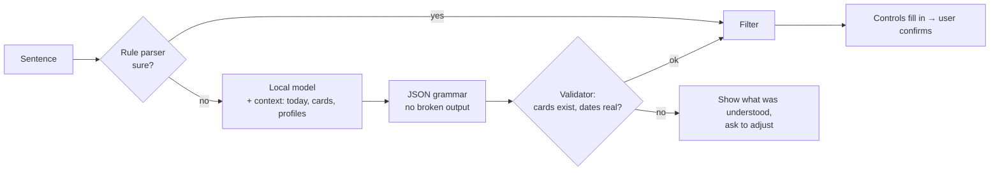

# AI in ShootDrop

**Status:** the smart box ships today with a rule parser. The local model is planned for v0.2
and nothing in v0.1 downloads or runs a model. This page is the design, so contributors can pick it up.

## The job

The AI has one narrow task: turn a sentence into a copy filter the app already understands.

```text
"kal ka sab footage, Pocket aur Lumix, for Sinhagad trip"
```

```json
{ "cards": ["POCKET4P", "LUMIX"], "dateFrom": "2026-11-22", "dateTo": "2026-11-22",
  "types": ["video", "audio"], "projectName": "Sinhagad trip",
  "splits": [ { "project": "Sinhagad", "to": "13:00" }, { "project": "Cafe review", "from": "13:01", "to": "18:00" } ] }
```

It never deletes anything. Since [ADR-008](adr/0008-autopilot-and-agent.md) the plan is that the person confirms **once** on a
single screen (or chooses a Countdown or fully automatic mode); see [AGENTS-GUIDE.md](AGENTS-GUIDE.md).

## How a request flows



1. **Rules first** (`ShootDrop.Core.SmartBox.RuleParser`): today, yesterday, last N days, dates and ranges,
   card names, file types, project name, Hinglish (`aaj`, `kal`, `din`, `sab`). Fast, deterministic, unit-tested.
   Since v0.3 the rules also read **time splits**: "copy yesterday's footage till 1 pm into Project A,
   till 6 pm into B and after 6 pm into C" (also "1-6pm", "between 2 and 5 pm", "1 baje tak").
   Each part becomes its own project; a clip goes to the part whose time holds the moment it stopped
   recording. "Split by breaks" suggests the parts from gaps in recording, no typing needed.
2. **Model second:** only when the rules aren't sure. The prompt includes today's date and the names of the
   plugged-in cards and known profiles.
3. **Constrained output:** llama.cpp grammar forces valid JSON matching the schema.
4. **Validation:** every value is checked against reality before it reaches the UI.

## Runtime and model

- **Runtime:** [LLamaSharp](https://github.com/SciSharp/LLamaSharp), the MIT-licensed .NET binding for llama.cpp.
  Runs on CPU on macOS, Windows and Linux, in-process.
- **Model:** a GGUF file under ~500 MB, answering in under 2 s on an 8 GB laptop. Candidates: Qwen2.5 0.5B
  (Apache 2.0), Gemma 3 270M, SmolLM2 135M. Shipped as an **optional download**, so the app stays small and
  works fully without it.
- **Privacy:** fully offline. No telemetry.

## The plan (and the learning part)

1. Prove it zero-shot with a ~0.5B model plus the JSON grammar.
2. Build a fixed eval set: ~200 real sentences with expected JSON, including Hinglish. Seed it from `RuleParserTests`.
3. Generate a few thousand synthetic sentence → JSON pairs with a large model, fine-tune a small one with LoRA.
4. Quantise to GGUF, score against the eval set, keep the smallest model that meets the accuracy target.
5. Run the eval in CI and report accuracy on every pull request.

Interested? Comment on the AI issue or open a draft PR. Start with step 2: the eval set needs no ML setup at all.
