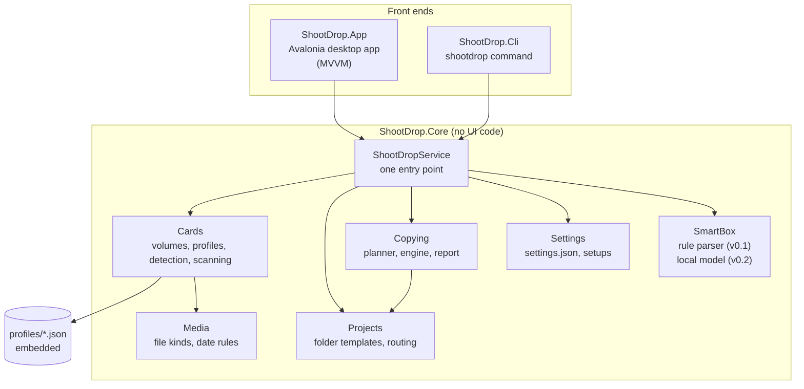

# Architecture

ShootDrop is one core library with two thin front ends. Everything that touches footage lives
in the core and is covered by tests; the UI and the CLI only call it. The reasoning behind each
choice is recorded as an [ADR](adr/).

## Big picture

## Projects in the solution

| Project | What it does |
| --- | --- |
| `src/ShootDrop.Core` | All logic. No Avalonia reference, no OS UI calls. Runs anywhere .NET runs. |
| `src/ShootDrop.App` | Avalonia desktop app. Pages are view models hosted by a `ShellViewModel`; views are XAML with compiled bindings. |
| `src/ShootDrop.Cli` | `shootdrop` command: `cards`, `plan`, `copy`, `ask`, `setups`, `config`. |
| `tests/ShootDrop.Core.Tests` | xUnit. Builds fake camera cards in temp folders, so no hardware is needed. |
| `profiles/` | Camera profiles as JSON, embedded into Core at build time. |

## A copy, step by step

1. **Detect.** `SystemVolumeProvider` lists mounted volumes (`/Volumes` on macOS, `/media` and `/run/media`
   on Linux, removable drives on Windows). `ProfileDetector` matches each against the camera profiles:
   strong signals first (marker folders, DCIM folder names, file prefixes), then audio-only recorders,
   and the volume name only when a `DCIM` folder exists. Disks that look like no camera are hidden.
2. **Scan.** `CardScanner` walks the card (skipping hidden and system folders) and classifies files by
   extension into video, audio, photo or proxy. The clip date is the file's last-write time today
   (reading it from metadata is on the roadmap).
3. **Plan.** `CopyPlanner` applies the date rule and file types, then `Routing` decides each file's folder.
   Order: rule by file kind (e.g. all audio → `Audio/DJI Mic`), then by card, then by profile, then the
   profile's default folder. An empty folder means "don't copy". If two cards produce the same file name
   in the same folder, the card name is added.
4. **Create the project.** `ProjectCreator` copies the user's template folder (never overwriting) and
   creates the folder tree.
5. **Copy and verify.** `CopyEngine` streams each file to `<name>.part` while computing xxHash64, flushes,
   re-reads the written file and hashes it again. Only a match is renamed to the final name and given the
   source's timestamp. A mismatch, error or cancel deletes the `.part`.
6. **Report.** `CopyReport` appends every file, size, checksum and result to `copy-report.txt` in the project.

## The safety rules (ADR-003)

1. Never write to, rename or delete anything on a source card. Sources are opened read-only.
2. A file counts as copied only after the written copy is re-read and its checksum matches.
3. Write `.part`, rename when verified.
4. Never overwrite in a project: identical → skip, different → `name (2)`.
5. Copy logic lives in Core only, and every Core change comes with a test.

## Settings

Stored as JSON in the user's app-data folder (`~/Library/Application Support/ShootDrop/settings.json` on macOS).
Settings carry a version number and are upgraded on load, so new features (for example, routing audio
separately in v2) apply to existing users without a reset.

## Why these choices

| Decision | Record |
| --- | --- |
| .NET 10 + Avalonia instead of Swift, Electron or Tauri | [ADR-001](adr/0001-stack-dotnet-avalonia.md) |
| Name and MIT license | [ADR-002](adr/0002-name-and-license.md) |
| One core, thin front ends, the safety rules | [ADR-003](adr/0003-architecture.md) |
| xxHash64 instead of MD5/SHA | [ADR-004](adr/0004-checksum-xxhash64.md) |
| Rules first, small local model later | [ADR-005](adr/0005-smart-box-and-local-ai.md) |
| Menu bar, shortcut, login item, card watching | [ADR-006](adr/0006-menu-bar-service.md) |
