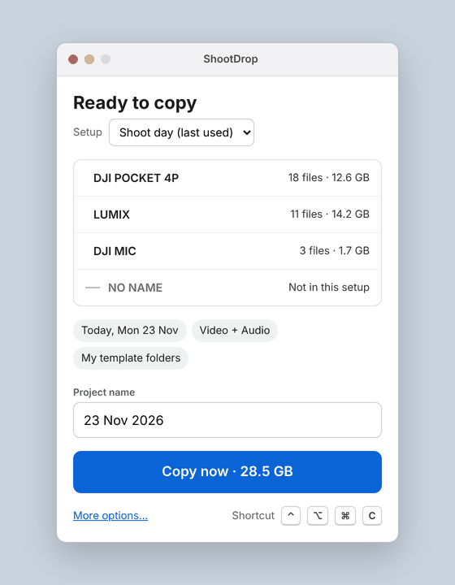
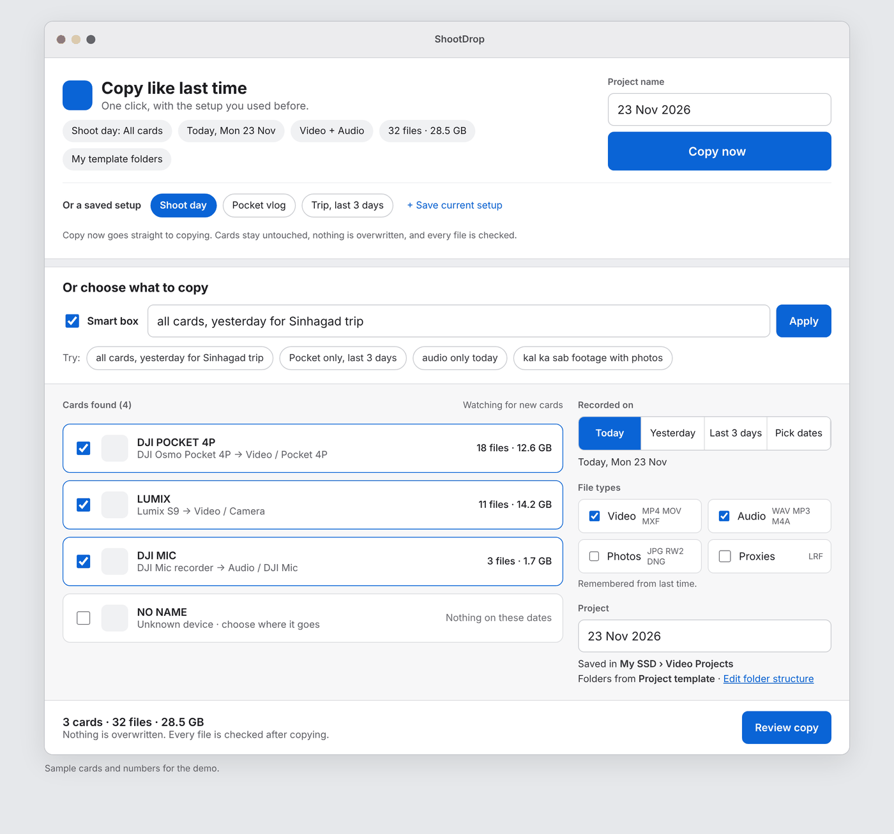
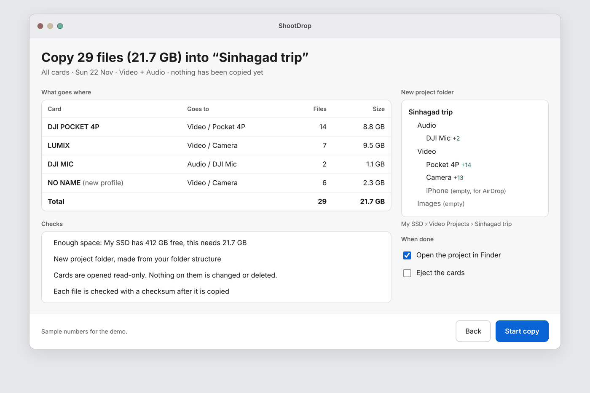
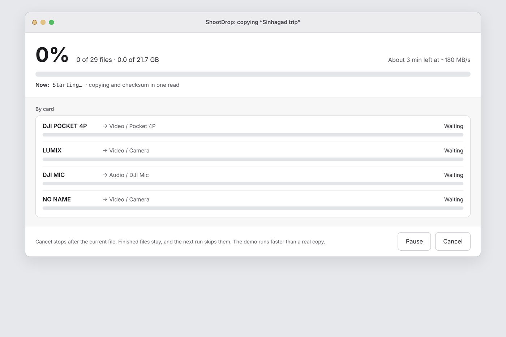
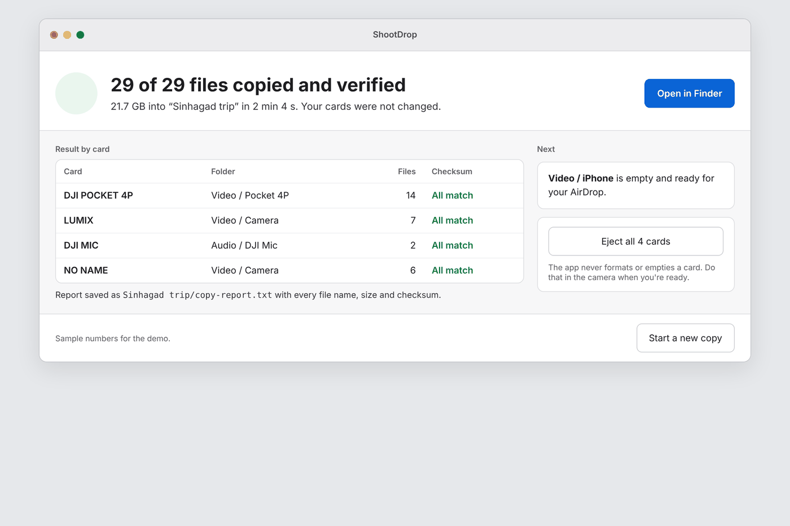
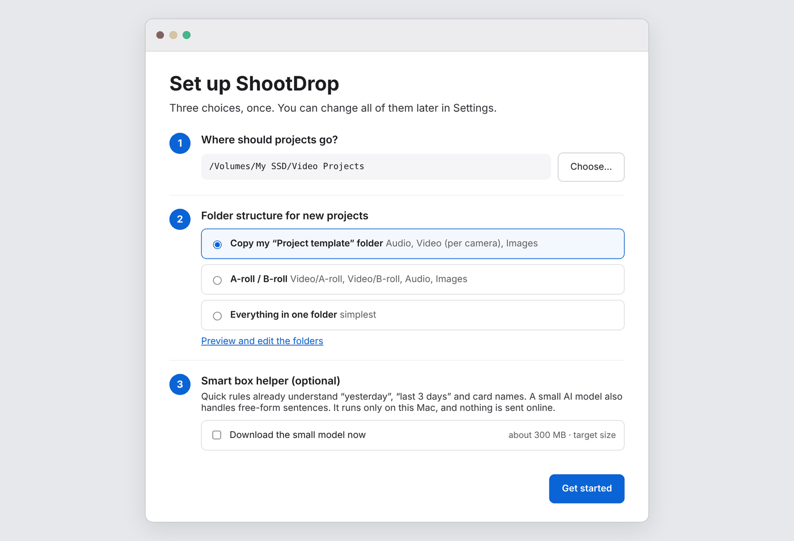
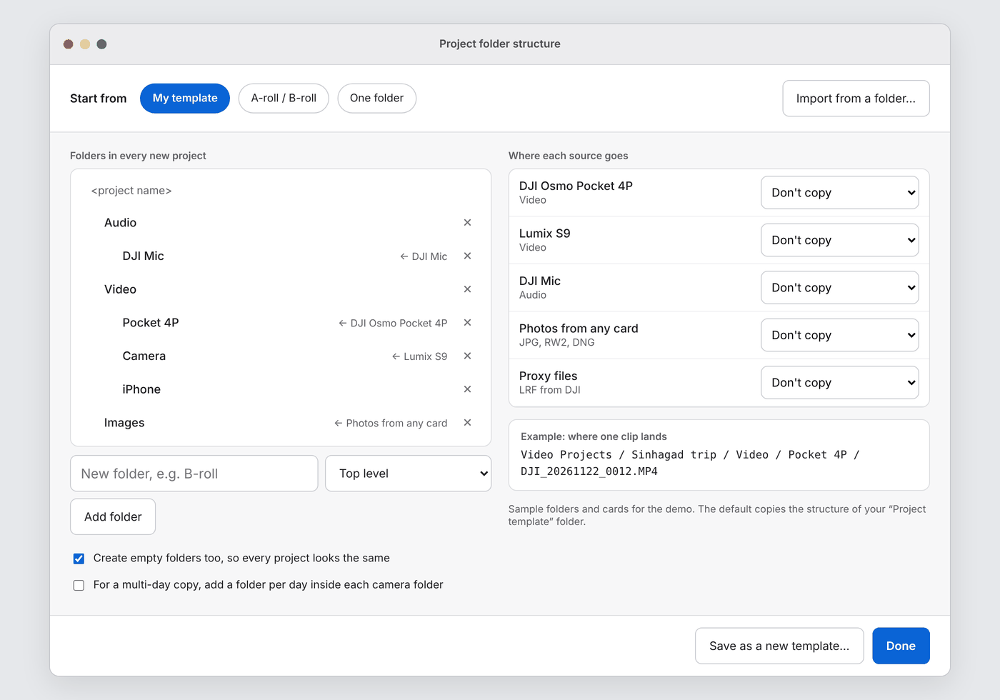
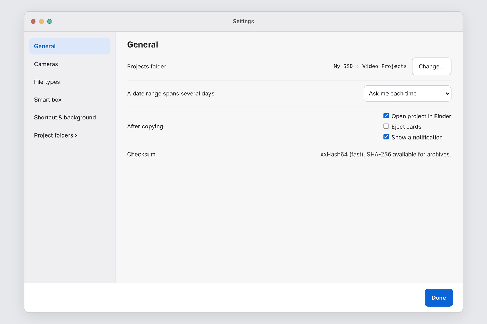
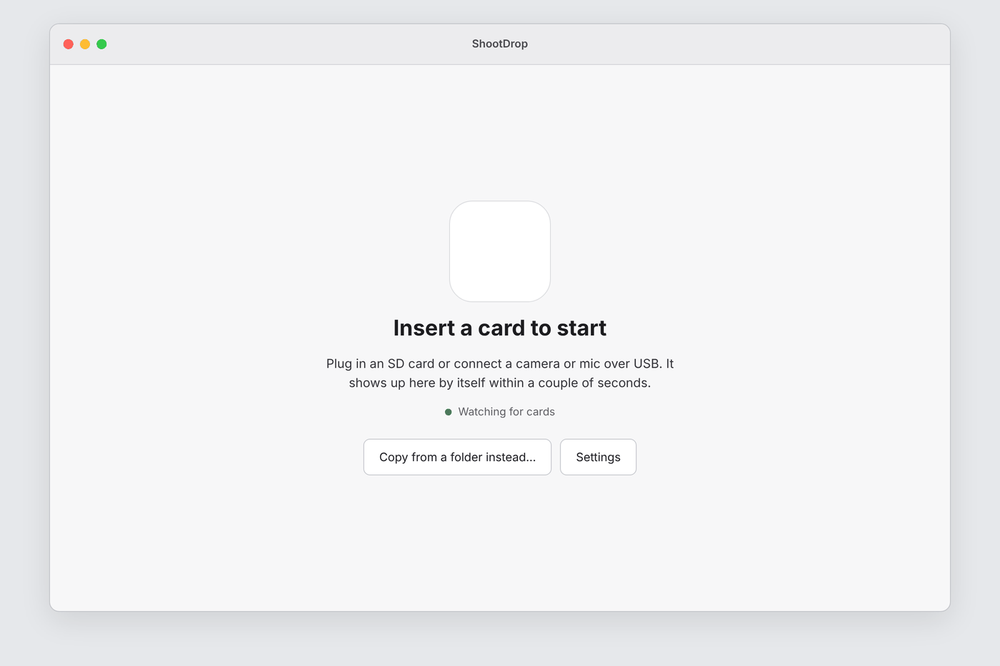
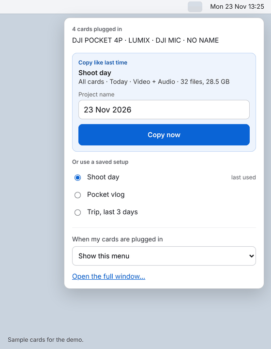

# Wireframes

ShootDrop was designed screen by screen before any code was written. These are the wireframes
the v0.1 app was built from: the flow, the layout and the words on each screen. The real app follows
them closely; sample cards and numbers are for the demo.

## The everyday flow

**Ready to copy** — the app opens on this small window. One button copies with the setup you used last time.

**Main window** — pick cards, dates and file types, or just type what you want in the smart box.

**Review** — what goes where, the new project folder, and the safety checks, before anything is copied.

**Copying and verifying** — progress per card; every file is checked after it's copied.

**Done** — every file verified, with Open in Finder and Eject.

## Setting up

**First run** — where projects go, which folder structure, and the optional AI helper (v0.2).

**Folder structure editor** — your own template, or A-roll / B-roll, and where each camera's files go.

**Settings**

## Edge cases and quick access

**No cards plugged in**

**Menu bar quick copy** — planned to become fully menu-bar-only in v0.2 (see the [roadmap](ROADMAP.md)).

